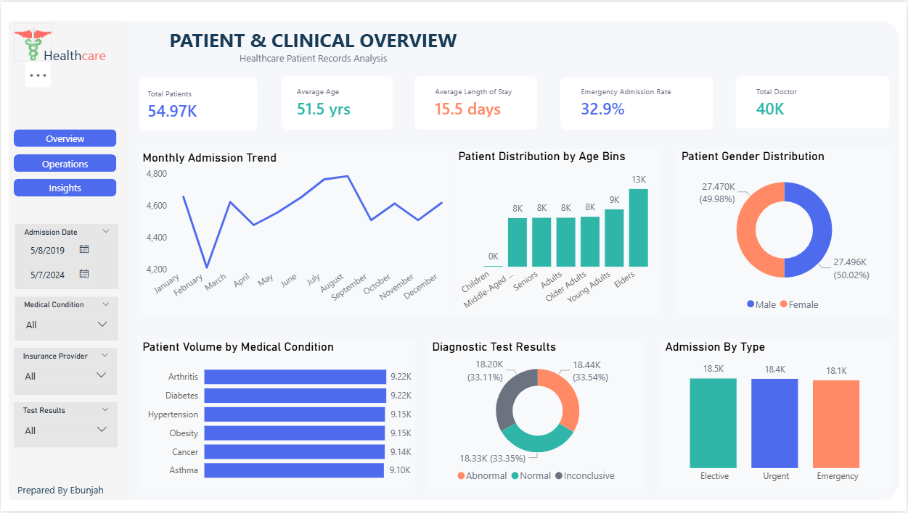

# Healthcare Patient Records Analysis 

## Project Overview
[Briefly explain what this project analyzes and why you created it.]

## Project Objectives
- Analyze patient demographics and age groups.
- Explore medical conditions and test-result categories.
- Compare admission types and admission trends over time.
- Calculate patient length of stay.
- Explore billing amounts and insurance-provider patterns.
- Identify data-quality issues that may affect reporting.

## Tools and Technologies
- Power BI
- Power Query
- DAX

## Dataset

The dataset used in this project contains healthcare patient records and was provided by my course instructor for learning and data analysis practice.

It contains 55,500 original records and 15 columns covering patient demographics, medical conditions, admission and discharge dates, hospitals, insurance providers, billing amounts, medications, and diagnostic test results.

### Dataset Information

- **Dataset Name:** Healthcare Patient Records
- **Dataset Source:** Provided by my course instructor
- **Original Records:** 55,500
- **Original Columns:** 15
- **Data Preparation:** Power Query
- **Analysis and Visualization:** Microsoft Power BI

## Data Cleaning and Preparation

Data preparation was carried out to improve consistency and prepare the healthcare patient records for analysis in Power BI.

The data quality checks and preparation tasks included:

- **Duplicate Records:** Identified 534 exact duplicate rows for review and removal where appropriate.
- **Date Formatting:** Reviewed admission and discharge dates and converted them to appropriate date data types where required.
- **Text Standardization:** Reviewed inconsistent capitalization in patient names.
- **Billing Validation:** Identified 108 records with negative billing amounts for further investigation.
- **Missing Values:** Checked the dataset for missing values.
- **Data Type Validation:** Reviewed column data types to ensure they were suitable for analysis.

Power Query was used for data preparation where applicable. Negative billing values were flagged for investigation rather than automatically treated as errors.

The prepared data was then used to build the Power BI dashboard.

## Key Performance Indicators (KPIs)

The dashboard presents key metrics across patient demographics, admissions, and financial performance.

### Patient & Clinical Overview

- **Total Patients:** Approximately 54.97K records displayed in the dashboard.
- **Average Age:** 51.5 years.
- **Average Length of Stay:** 15.5 days.
- **Emergency Admission Rate:** 32.9%.
- **Total Doctors:** Approximately 40K as displayed in the dashboard.

### Operations & Financial Performance

- **Total Billing:** Approximately $1.4 billion.
- **Average Billing:** Approximately $25.5K.
- **Emergency Admission Rate:** 32.9%.
- **Negative Billing Rate:** 0.2%.
- **Total Insurance Providers:** 5.

These KPIs provide a summary of the patient records and billing metrics analyzed in the dashboard. Values may change when filters are applied.

## Dashboard Pages and Visuals

### Page 1: Patient & Clinical Overview

**Purpose:** 
To explore patient demographics, medical conditions, admission patterns, and diagnostic test results.

**Visuals included:**
- Monthly Admission Trend
- Patient Distribution by Age Bins
- Patient Gender Distribution
- Patient Volume by Medical Condition
- Diagnostic Test Results
- Admission by Type

**Slicers/Filters:** Admission Date, Medical Condition, Insurance Provider, Test Results.

### Page 2: Operations & Financial Performance

**Purpose:** 
To examine healthcare billing patterns, insurance-provider totals, hospital billing, and length of stay by admission type.

**Visuals included:**
- Billing by Insurance
- Average Billing by Condition
- Length of Stay by Admission
- Top Hospital by Billing

**Slicers/Filters:** Admission Date, Medical Condition, Insurance Provider, Test Results.

## Dashboard Preview

### Page 1: Patient & Clinical Overview

This page provides an overview of patient demographics, medical conditions, admission trends, and diagnostic test results.

### Page 2: Operations & Financial Performance

This page explores healthcare billing, insurance-provider comparisons, average billing by medical condition, length of stay, and hospital billing performance.

## Key Insights

1. **Medical Conditions:** Arthritis and Diabetes each account for approximately 9.22K records, making them the highest categories displayed in the medical-condition chart.
2. **Length of Stay:** The average length of stay is approximately 15.5 days, with small differences across Emergency, Elective, and Urgent admissions.
3. **Billing Performance:** Cigna has the highest displayed billing total among the five insurance providers, at approximately $284.334 million.

## Recommendations

1. **Review admission trends:** Examine monthly admission patterns to support staffing and resource planning.
2. **Investigate length of stay:** Compare stays by hospital, medical condition, and admission type to identify patterns that may require further review.
3. **Monitor billing quality:** Investigate negative billing values to determine whether they represent adjustments, refunds, or data errors.
4. **Review insurance billing:** Compare billing totals alongside patient volumes to better understand differences between insurance providers.

## Challenges and Learnings
**Challenges:** [Describe any data-quality or technical challenges you encountered.]

**What I learned:** [Describe what you learned about Power Query, DAX, data visualization, or communicating insights.]

## Limitations
- [Mention limitations of the dataset or analysis.]
- Observed patterns do not automatically prove cause and effect.
- Findings should be interpreted within the context of the dataset and its source.

## How to View the Project
1. [Explain where to find the `.pbix` file, if you share it.]
2. [Explain any requirements for opening the report.]
3. [Explain how to view the screenshots or reproduce the analysis.]

## Skills Demonstrated
- Data cleaning and transformation
- Power Query
- DAX and KPI development
- Data visualization
- Dashboard design
- Exploratory data analysis
- Data storytelling

## Author

**Ebunjah**  
**Role:** Certified Data Analyst  
**Portfolio:** https://ebunjah-portfolio.carrd.co/  
**LinkedIn:** https://www.linkedin.com/in/ogungbe-ebunoluwa/
